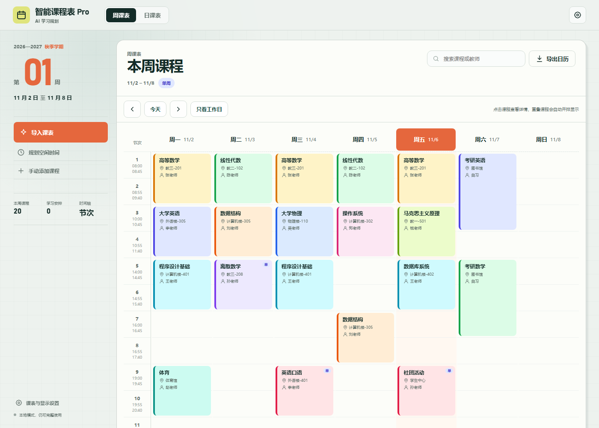
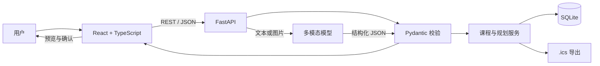

# 智能课程表 Pro

> AI 驱动的课表导入与学习规划助手。




智能课程表 Pro 面向大学生的高频场景：从格式混乱的教务排课文本或截图中提取课程，预览并修正解析结果，生成可编辑的周课表，再根据真实空闲时间安排自习、考研或考公任务。

这个项目重点展示 AI 应用开发中的完整闭环，而不只是调用一次大模型接口：

- 输入：粘贴教务文本或上传课表截图
- 解析：OpenAI 兼容多模态接口 + 结构化 JSON 协议
- 校验：Pydantic 二次校验和字段容错
- 确认：导入前预览，用户修正后再写入数据库
- 降级：AI 不可用时，文本导入退回本地规则解析
- 应用：持久化课表、空闲规划、冲突提示与 `.ics` 导出

## 功能

- 周课表、日课表以及移动端响应式布局
- 课程增删改查，数据持久化到 SQLite
- 单周、双周、自定义周次
- 冲突课程自动并排分栏，保留可点击详情
- 节次时间轴与 24 小时时间轴、精确起止时间
- 可配置作息、每周第一天、周末显示和节假日
- 第几周快速跳转
- 课程“移动 / 覆盖 / 交换”调课
- 深色模式、网格密度、背景主题、透明度及字段显隐
- AI 文本/截图课表导入
- Excel / CSV 规则导入，支持列映射、表头识别、自定义时间正则和逐行警告
- 可保存教务导入模板，并支持多校区作息规则
- 导入时可选择追加、跳过重复、覆盖同名或整体替换
- 无模型密钥时的规则解析和本地规划降级
- 自动计算空闲时间并生成学习计划
- 版本化 JSON 导入导出，兼容拾光课程表导出格式
- RFC 5545 `.ics` 导出
- 健康检查、结构化日志、自动化测试与 CI

## 技术栈

| 层 | 技术 | 选择原因 |
|---|---|---|
| 前端 | React 19、TypeScript、Vite | 组件化、类型安全、快速构建 |
| 样式 | 原生 CSS Design Tokens | 保持零 UI 框架依赖，突出响应式与可访问性 |
| 后端 | FastAPI、Pydantic | API 契约、请求校验、自动 OpenAPI 文档 |
| 数据 | SQLAlchemy 2、Alembic、SQLite | 版本化迁移，可平滑迁移到 PostgreSQL |
| 表格解析 | openpyxl、xlrd、标准库 CSV | 安全读取教务 Excel/CSV，不执行公式 |
| AI | OpenAI 兼容接口 | 支持 OpenAI、DeepSeek、通义或自建网关 |
| 测试 | pytest、Vitest、Playwright | 覆盖后端业务规则、前端纯函数和真实浏览器流程 |
| 质量 | Ruff、pytest、Vitest、Playwright | 静态检查、单元测试和真实浏览器验证 |
| 部署 | Docker、GitHub Actions | 可复现构建与持续集成 |

## 架构



AI 导入不会把模型输出直接写入数据库。流程如下：

```text
文本/截图 -> 模型结构化输出 -> JSON 提取 -> Pydantic 校验
         -> 冲突提示 -> 用户预览确认 -> SQLite
```

## 快速开始

### 方式一：Docker Compose

要求安装 Docker Desktop，并确保 Docker Engine 已启动：

```powershell
docker version
docker compose version
```

在 PowerShell 中进入项目目录并启动：

```powershell
cd "D:\智能课程表pro（v10)"
docker compose up --build
```

首次构建会完成前端编译、后端依赖安装、数据库迁移和静态页面托管。启动后访问：

- 应用：<http://localhost:8000>
- Swagger API 文档：<http://localhost:8000/docs>
- 健康检查：<http://localhost:8000/api/health>

后台运行、查看日志和停止服务：

```powershell
docker compose up --build -d
docker compose logs -f timetable
docker compose down
```

`docker compose down` 不会删除 SQLite 数据。只有执行下面的命令才会清除数据卷：

```powershell
docker compose down -v
```

项目默认使用 DaoCloud 基础镜像代理、npmmirror 和清华 PyPI 镜像，适合当前网络环境。如果仍无法拉取基础镜像，可在 `.env` 中覆盖：

```dotenv
NODE_IMAGE=docker.m.daocloud.io/library/node:22-alpine
PYTHON_IMAGE=docker.m.daocloud.io/library/python:3.12-slim
NPM_REGISTRY=https://registry.npmmirror.com
PIP_INDEX_URL=https://pypi.tuna.tsinghua.edu.cn/simple
```

若当前网络可以直连官方源，也可以改用 `node:22-alpine`、`python:3.12-slim`、`https://registry.npmjs.org` 和 `https://pypi.org/simple`。

### Docker 构建排错

如果出现：

```text
ERROR [internal] load metadata for docker.io/library/node:22-alpine
```

说明 Docker 无法访问 Docker Hub，与 Python、前端代码或 SQLite 无关。项目已经默认使用：

```text
docker.m.daocloud.io/library/node:22-alpine
docker.m.daocloud.io/library/python:3.12-slim
```

修改 Dockerfile 或 `.env` 后，建议强制重建：

```powershell
docker compose build --no-cache
docker compose up
```

还可以分别验证镜像是否可拉取：

```powershell
docker pull docker.m.daocloud.io/library/node:22-alpine
docker pull docker.m.daocloud.io/library/python:3.12-slim
```

如果提示端口被占用，请关闭旧的 `8000` 端口进程。不要使用 `docker compose down -v` 排查端口问题，因为该命令会删除数据库卷。

### 方式二：前后端分开开发

要求：Python 3.12+、Node.js 22+。

```bash
python -m venv .venv
# Windows
.venv\Scripts\activate
# macOS / Linux
source .venv/bin/activate

pip install -r requirements-dev.txt
cd frontend
npm install
```

终端一启动后端：

```bash
# Windows
.\.venv\Scripts\python -m server

# macOS / Linux
./.venv/bin/python -m server
```

终端二启动前端：

```bash
cd frontend
npm run dev
```

开发地址：`http://localhost:5173`  
API 文档：`http://localhost:8000/docs`

如果希望由 FastAPI 在单一端口提供完整应用，先运行 `cd frontend && npm run build`，再启动后端并访问 `http://localhost:8000`。

数据库迁移会在应用启动时自动执行，也可以手动运行：

```bash
alembic upgrade head
```

`python -m server` 支持以下环境变量：

| 变量 | 默认值 | 用途 |
|---|---|---|
| `TIMETABLE_HOST` | `127.0.0.1` | 服务监听地址 |
| `TIMETABLE_PORT` | `8000` | 服务端口 |
| `TIMETABLE_RELOAD` | `false` | 开发热重载 |

PowerShell 开发模式示例：

```powershell
$env:TIMETABLE_RELOAD="true"
.\.venv\Scripts\python -m server
```

## AI 配置

复制 `.env.example` 为 `.env`，然后填写兼容 OpenAI Chat Completions 的配置：

```dotenv
TIMETABLE_AI_API_KEY=your-key
TIMETABLE_AI_BASE_URL=https://api.openai.com/v1
TIMETABLE_AI_MODEL=gpt-4o-mini
TIMETABLE_AI_TIMEOUT=60
```

API Key 只保存在服务端，不会返回给浏览器。未配置密钥时，应用仍可使用文本规则导入、课表管理和本地空闲规划。

## 测试

Windows 下可直接执行统一检查：

```powershell
.\scripts\check.ps1
```

也可以分别运行：

```bash
pytest
cd frontend
npm run test
npm run build
```

使用系统已安装的 Edge/Chromium 执行真实浏览器冒烟测试：

```bash
cd frontend
EDGE_PATH=/path/to/msedge npm run e2e
```

测试覆盖：

- 课程 CRUD 与数据库持久化
- 非法课程数据拒绝
- 单双周重叠判断
- 文本课表规则解析
- Excel/CSV 表头识别、列映射与多段节次解析
- 导入配置模板和多校区作息规则
- 空闲时间切分
- ICS 必需字段和转义

当前验证结果：

- 后端：14 项 pytest 测试通过
- 前端：9 项 Vitest 测试通过
- Playwright：实际 Edge 浏览器中完成新增课程、精确时间、冲突并排、刷新持久化、AI 文本导入、JSON 导入、CSV 导入、设置保存和日历导出
- 前端生产构建通过，浏览器控制台无报错

## API

| 方法 | 路径 | 用途 |
|---|---|---|
| GET | `/api/courses` | 获取课程 |
| POST | `/api/courses` | 新建课程 |
| PUT | `/api/courses/{id}` | 修改课程 |
| DELETE | `/api/courses/{id}` | 删除课程 |
| POST | `/api/import/courses` | 解析文本或截图中的课程 |
| POST | `/api/courses/import` | 确认导入课程草稿 |
| POST | `/api/ai/plan` | 根据空档生成学习建议 |
| GET | `/api/export/ics` | 导出 RFC 5545 日历 |
| GET / PUT | `/api/schedule-config` | 读取或更新学期、作息、显示和假期 |
| POST | `/api/courses/reschedule` | 移动、覆盖或交换课程 |
| POST | `/api/import/json/preview` | 预览本项目或拾光 JSON |
| POST | `/api/import/json/commit` | 确认导入 JSON |
| GET | `/api/export/json` | 导出课程、作息、学期和假期 |
| POST | `/api/import/tabular/preview` | 上传并解析 Excel/CSV |
| POST | `/api/import/tabular/commit` | 按策略确认写入表格课程 |
| GET | `/api/import-profiles` | 获取教务导入模板 |
| DELETE | `/api/import-profiles/{id}` | 删除教务导入模板 |
| GET | `/api/self-plans` | 获取学习规划 |
| POST | `/api/self-plans` | 新建学习规划 |
| DELETE | `/api/self-plans/{id}` | 删除学习规划 |
| GET | `/api/health` | 服务健康检查 |
| GET | `/api/config` | 获取课表、AI 与显示配置 |

完整请求模型和响应示例可在 Swagger 的 `/docs` 中查看。

## 关键工程决策

### 数据持久化

浏览器不再把示例数据当作用户数据源。课程由后端数据库提供，演示数据只在数据库首次初始化时写入一次，因此刷新页面不会覆盖用户修改。

### AI 容错

- 只接受服务端配置的密钥
- 限制输入长度
- 从 Markdown 代码块中提取 JSON
- Pydantic 二次校验
- 网络连接短退避重试与超时控制
- AI 失败时返回可解释的降级状态

### 日历导出

生成包含 `UID`、`DTSTAMP`、`DTSTART`、`DTEND` 的 `VEVENT`，并对中文、逗号、分号和换行进行转义。

## 目录结构

```text
.
├── frontend/               # React + TypeScript 前端
├── server/app/             # FastAPI 后端
│   ├── __main__.py         # python -m server 跨平台入口
│   ├── main.py
│   ├── database.py
│   ├── models.py
│   ├── schemas.py
│   └── services/
├── migrations/             # Alembic 版本化迁移
├── tests/                  # 后端测试
├── docs/                   # 架构、设计决策和修改路线图
├── scripts/check.ps1       # 静态检查、测试和构建
├── Dockerfile
└── docker-compose.yml
```

## 已知限制

- AI 解析效果依赖所配置模型；图片导入目前使用多模态兼容接口，不包含本地 OCR。
- 暂未提供账号体系，适合个人本地使用或单用户演示。
- SQLite 适合作品集和单机部署，多用户生产环境应迁移到 PostgreSQL。
- 演示站点需要单独配置模型调用额度与速率限制。
- Excel 导入当前读取工作簿的第一个工作表，尚未提供多工作表选择。
- Docker 配置已经切换到镜像代理；当前 Codex 执行环境没有 Docker CLI，容器启动需要在本机 Docker Desktop 中完成。

## Roadmap

详细的验收标准和完成状态见 [docs/ROADMAP.md](docs/ROADMAP.md)。

组件边界、AI 状态机和故障策略见 [docs/ARCHITECTURE.md](docs/ARCHITECTURE.md)。  
开源参考和许可边界见 [docs/THIRD_PARTY_NOTICES.md](docs/THIRD_PARTY_NOTICES.md)。

## License

[MIT](LICENSE)
