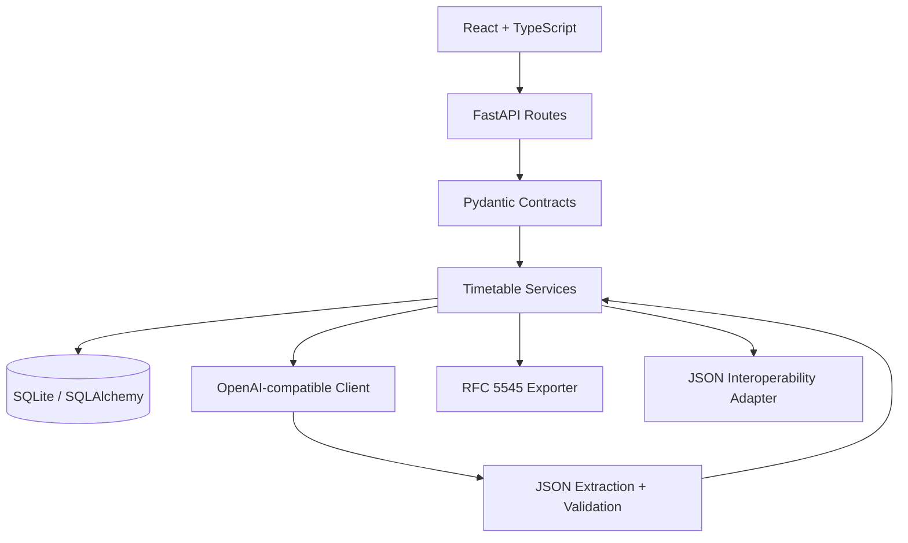
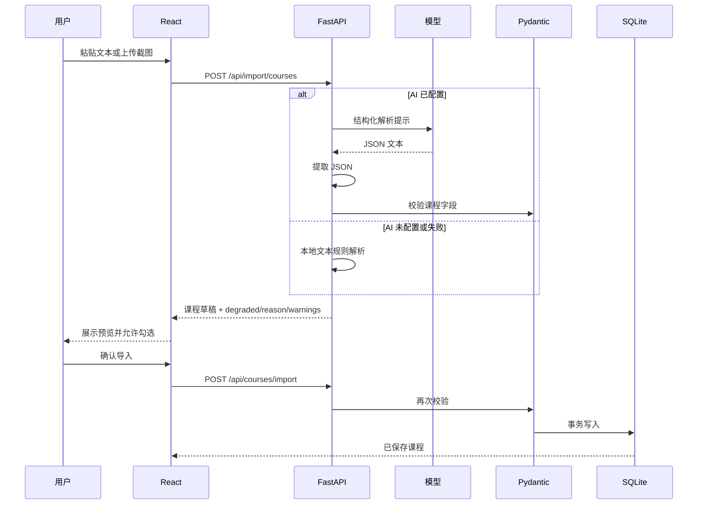

# 架构说明

## 目标

智能课程表 Pro 的核心目标不是展示一个静态课程表，而是完成 AI 数据处理到业务落库的可靠闭环：

1. 接收非结构化的教务文本或排课截图。
2. 提取并校验课程结构。
3. 让用户在写入前检查解析结果。
4. 提供可持久化的课表与学习规划。
5. 在 AI 不可用时保留可用的本地能力。

## 分层

### 前端

- `App.tsx`：页面状态、数据加载和顶层交互。
- `ScheduleView.tsx`：周/日视图渲染和课程定位。
- `CourseForm.tsx`：课程表单、颜色、周次和时间段。
- `ImportDialog.tsx`：文本/截图解析、结果预览和确认。
- `PlannerDialog.tsx`：空档计算、任务分配和 AI 建议。
- `api.ts`：唯一 HTTP 数据边界。
- `utils.ts`：可独立测试的日期、冲突、空档和切分逻辑。

前端不直接保存课程数据。IndexedDB/localStorage 只用于学期总周数和开学日期等设备偏好。

### 后端

- `main.py`：路由、请求日志、CORS 和静态资源托管。
- `schemas.py`：请求和响应契约。
- `models.py`：SQLAlchemy 数据模型。
- `services/importer.py`：模型输出与本地规则解析。
- `services/ai.py`：上游模型调用、限流、超时和降级。
- `services/ics.py`：日历事件构建、转义和折行。

## AI 导入状态机

用户确认是安全边界。模型输出即使格式错误、字段越界或包含提示注入内容，也不能直接写入数据库。

## 数据模型

`courses` 保存课程名称、教师、颜色、周次类型和多个时间段。`sections` 使用 JSON 保存，因为时间段数量少且总随课程整体读取；后续若出现跨课程时间段查询，可拆分为独立表。

`self_plans` 保存用户确认后的自习、考研或考公安排，按日期和具体分钟定位。

`app_meta` 只记录一次性种子初始化状态。即使用户删除全部课程，重启时也不会自动恢复演示课程。

新增的 `timetable_settings`、`schedule_time_slots` 和 `holidays` 表保存单课表实例的学期、作息、显示偏好和假期。首次启动会由 Alembic 建立基线结构，随后才写入演示课程。

## 课表布局

`frontend/src/scheduleLayout.ts` 会把普通节次、精确时间和 24 小时模式统一转换成浮点网格坐标。同一天的课程按时间形成重叠 cluster，再为 cluster 分配并排 lane。这样冲突课程不会互相覆盖，点击任意课程块仍然可以打开对应详情。

## 数据互操作

`GET /api/export/json` 输出带 `schema_version` 的完整快照。导入支持：

- 本项目版本化 JSON
- 拾光课程表的 `courses + timeSlots + config` 字段

所有导入先转换成统一的 `CourseCreate` 契约，再经过 Pydantic 校验和用户预览。兼容映射不会绕过校验，也不会直接覆盖现有数据。

## 表格导入

`server/app/services/tabular_importer.py` 只读取 `.xlsx`、`.xls` 和 `.csv` 的前 5000 行数据。Excel 文件先检查大小、文件数量、解压体积和压缩比，再使用只读、`data_only` 模式读取；不执行公式，也不接受带宏的 `.xlsm`。

解析器自动寻找表头，并识别课程、时间、地点和教师列的常见中英文别名。上课时间支持节次列表、连续节次、周次区间、单双周和多时间段。格式特殊的教务系统可以配置包含“星期、节次、周次”三个捕获组的正则，正则会随导入模板一起保存。地点数量无法一一对应时返回 warning，而不是静默复用错误地点。

导入模板保存在 `import_profiles` 表中。多校区作息用地点关键词映射到独立节次表；匹配后同时写入精确起止时间，因此显示和 ICS 导出都不依赖全局作息。

## 故障策略

| 故障 | 行为 |
|---|---|
| 未配置 API Key | 文本使用本地解析；图片明确提示需要模型 |
| 模型超时 | 返回 `AI_TIMEOUT`，前端提示降级 |
| 网络连接失败 | 短退避重试后返回 `AI_NETWORK` |
| 上游 4xx/5xx | 返回可解释原因，不覆盖已有课程 |
| 非法 JSON | 尝试提取 JSON 对象，再失败则降级 |
| 字段越界 | Pydantic 拒绝对应课程并返回 warning |
| 数据库不可用 | API 返回错误，前端显示连接失败页 |
| 浏览器刷新 | 从 SQLite 恢复课程，不使用演示数据覆盖 |
| 节假日 | 课表显示假期状态，规划与 ICS 跳过课程 |
| 调课源日期为空 | 返回 `moved=0` 和明确 warning，不产生空事务 |

## 安全约束

- API Key 只通过服务端环境变量读取。
- 前端文本由 React 默认转义，不使用 `dangerouslySetInnerHTML`。
- 请求字段有长度、枚举和数值范围限制。
- 图像输入限制为 data URL 和 9MB 字符上限。
- AI 系统提示明确将用户文本和图片视为数据，不视为指令。
- CORS 默认只允许本地开发来源；生产同源部署不需要额外开放。

## 当前权衡

- 选择 SQLite 是为了让面试官可以零配置启动。生产多用户场景应迁移 PostgreSQL。
- 暂未加入登录系统，避免作品集中出现不完整的权限实现。
- 图片解析依赖多模态模型，不额外引入本地 OCR，先把模型协议和降级边界做清楚。
- 前端使用原生 CSS 而不是 UI 框架，便于展示响应式布局和视觉设计能力。
